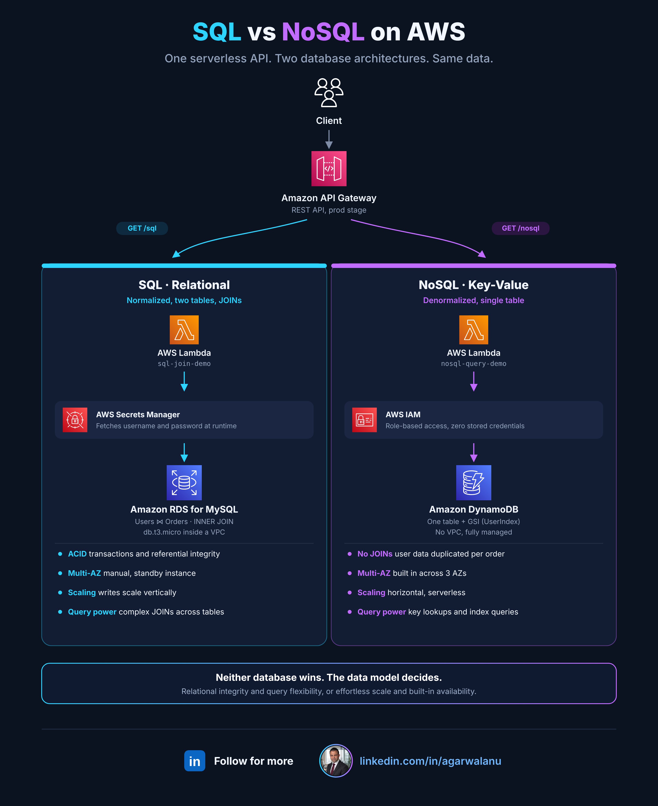
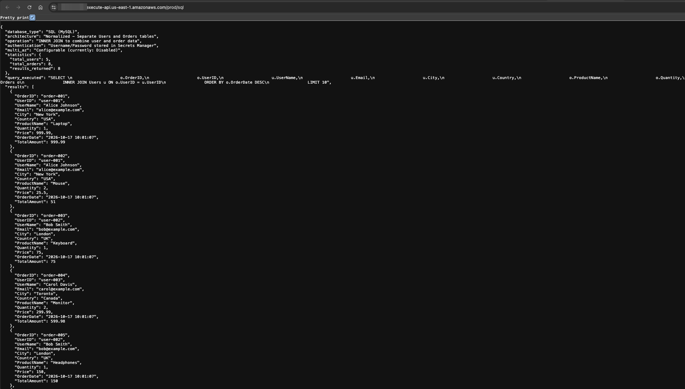
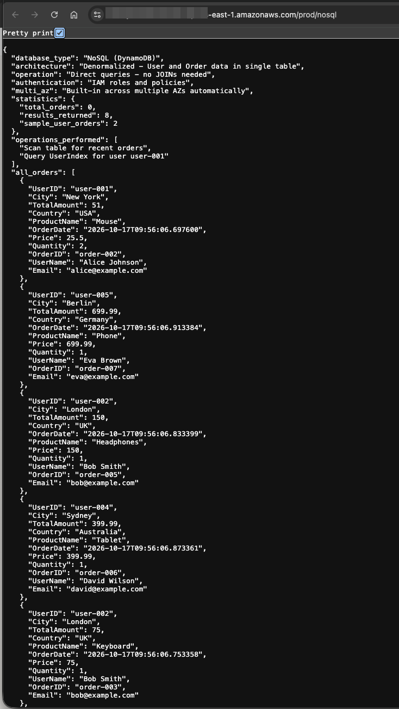
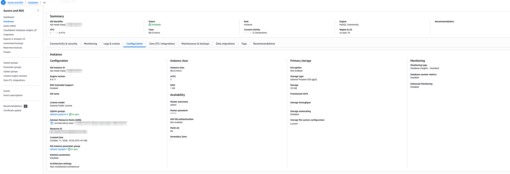

# SQL vs NoSQL on AWS: One API, Two Database Architectures

I built the same e-commerce ordering API twice: once on Amazon RDS for MySQL with a fully normalized schema, and once on Amazon DynamoDB with a denormalized single-table design. Same users, same orders, same API Gateway front door. The point was to compare the two architectures where it actually matters: data modeling, authentication, availability, and scaling.

## Architecture



One REST API on Amazon API Gateway exposes two routes. Each route invokes its own Lambda function, and each function talks to a different database engine holding identical business data.

| Component | Service | Role |
|---|---|---|
| API front door | Amazon API Gateway (REST, `prod` stage) | Routes `GET /sql` and `GET /nosql` to their Lambda functions |
| SQL query engine | AWS Lambda (`sql_join_demo.py`) | Connects to MySQL with PyMySQL and runs an INNER JOIN across tables |
| NoSQL query engine | AWS Lambda (`nosql_query_demo.py`) | Scans and queries DynamoDB through boto3, no JOINs required |
| Relational store | Amazon RDS for MySQL 8.4 (db.t3.micro) | Normalized `Users` and `Orders` tables with a foreign key |
| Key-value store | Amazon DynamoDB | Single denormalized table with a `UserIndex` GSI |
| SQL credentials | AWS Secrets Manager | Stores the MySQL username and password, fetched at runtime |
| NoSQL credentials | AWS IAM | Execution-role policy grants table access, no stored secrets |

## Request flow

1. A client calls `GET /sql` or `GET /nosql` on the API Gateway endpoint.
2. API Gateway invokes the matching Lambda function.
3. The SQL path first calls Secrets Manager for the database username and password, opens a PyMySQL connection into the VPC, and runs an INNER JOIN combining `Orders` with `Users`, computing `Quantity * Price` as the order total.
4. The NoSQL path needs no credential step. Its IAM execution role authorizes it directly, so it scans the table for recent orders and runs a `Query` against the `UserIndex` GSI for one user's orders.
5. Both functions seed their own sample data idempotently on first invocation, so the comparison is reproducible from a cold start.
6. Each response returns the records plus metadata describing the architecture that produced them, which makes the two models easy to diff side by side.

## What the comparison showed

### Data modeling
The relational model keeps one copy of each user and reaches it through a JOIN at query time:

```sql
SELECT o.OrderID, u.UserName, u.Email, u.City, u.Country,
       o.ProductName, o.Quantity, o.Price,
       (o.Quantity * o.Price) AS TotalAmount
FROM Orders o
INNER JOIN Users u ON o.UserID = u.UserID
ORDER BY o.OrderDate DESC;
```

DynamoDB stores the user's name, email, city, and country inside every order item. Storage is duplicated so that reads become single-digit-millisecond key lookups with no relational work at all.

### Authentication
The SQL function cannot open a connection without first retrieving a username and password from Secrets Manager. The DynamoDB function contains no credential code whatsoever; its IAM role is the authentication. That is one less secret to store, rotate, and leak.

### Availability
Multi-AZ on RDS is a deliberate configuration choice. Enabling it on an existing instance causes disruption, which is why it belongs at creation time or in a maintenance window. DynamoDB replicates across three Availability Zones automatically, with nothing to configure.

### Scaling
RDS runs on an EC2 instance class underneath (a db.t3.micro here). Write capacity scales vertically by resizing that instance; read replicas can offload reads but writes stay on the primary. DynamoDB scales horizontally in both directions as a managed service.

### Networking
RDS must live inside a VPC, ideally in private subnets. DynamoDB cannot be placed inside a VPC; private access from VPC resources goes through a VPC endpoint instead of the public internet.

## Verdict

| Decision factor | RDS for MySQL | DynamoDB |
|---|---|---|
| Data model | Normalized, JOINs, referential integrity | Denormalized, duplicated attributes |
| Consistency | ACID transactions | Eventually consistent by default |
| Authentication | Credentials via Secrets Manager | IAM role, zero stored secrets |
| High availability | Manual Multi-AZ standby | Built in across three AZs |
| Write scaling | Vertical (bigger instance) | Horizontal (managed) |
| Best fit | Complex queries, transactional integrity | High-scale key-based access patterns |

Neither engine wins outright. If the workload needs ad hoc queries, multi-table transactions, and strict integrity, relational earns its operational overhead. If the access patterns are known up front and scale or availability dominate, DynamoDB removes entire categories of work. The data model decides, not the fashion.

## Screenshots

| | |
|---|---|
| SQL API response with the executed JOIN |  |
| NoSQL API response with denormalized items |  |
| RDS instance configuration (Multi-AZ, instance class, storage) |  |

## Repository layout

```
.
├── lambda/
│   ├── sql_join_demo.py       # RDS MySQL path: Secrets Manager + PyMySQL + INNER JOIN
│   └── nosql_query_demo.py    # DynamoDB path: IAM auth + Scan + GSI Query
├── assets/
│   ├── architecture.png
│   └── architecture.svg
└── screenshots/
```

## Skills demonstrated

- Serverless API design with API Gateway and Lambda
- Relational schema design, foreign keys, and JOIN queries on RDS MySQL
- DynamoDB single-table design with a Global Secondary Index
- Credential management with Secrets Manager versus IAM role-based authorization
- High-availability and scaling trade-off analysis (Multi-AZ, read replicas, vertical vs horizontal scaling)
- VPC networking considerations, including VPC endpoints for DynamoDB

## Connect


*Built and measured by Anu Agarwal — [linkedin.com/in/agarwalanu](https://www.linkedin.com/in/agarwalanu)*


